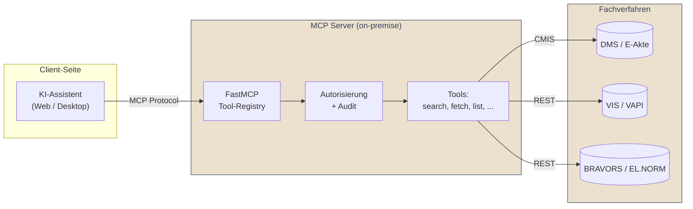

# Referenzarchitektur: MCP-Anbindung an Fachverfahren

## Hintergrund

Das **Model Context Protocol (MCP)** standardisiert die Anbindung von KI-Assistenten an externe Datenquellen und Funktionen. Für die öffentliche Verwaltung ist MCP besonders interessant, weil es eine **kontrollierte, auditierbare Schnittstelle** zwischen LLM und Fachverfahren bietet, ohne dass das Sprachmodell direkten Datenbankzugriff erhält.

## Architekturmuster

## Vorteile gegenüber direkter LLM-Integration

| Aspekt | Direkte Integration | MCP-basiert |
|---|---|---|
| Funktionsumfang | Im Anwendungs-Code verdrahtet | Deklarativ über Tool-Definitionen |
| Auditierung | Implementierungsabhängig | Zentral am MCP-Server |
| Modellaustausch | Erfordert Anpassungen | Modellunabhängig |
| Wiederverwendung | Pro Anwendung neu | Ein Server bedient mehrere Assistenten |

## Sicherheitsprinzipien

- **Least Privilege**: Jedes Tool exponiert nur die minimal notwendigen Operationen.
- **Kontextbindung**: Tool-Aufrufe werden gegen die Identität der aufrufenden Sitzung autorisiert, nicht gegen einen Service-Account.
- **Strikte Eingabevalidierung**: Tool-Parameter werden vor Weiterleitung an Backends validiert. Schutz vor Prompt Injection durch Trennung von Anweisungs- und Datenkontext.
- **Vollständiges Audit-Log**: Jeder Tool-Aufruf wird mit Zeitstempel, Nutzer, Parametern und Ergebnis-Hash protokolliert.

## Typische Tool-Definitionen für Verwaltungskontexte

- `search_documents(query, max_results)` – semantische Suche im DMS
- `fetch_document(document_id)` – Volltext eines Dokuments, autorisierungsgeprüft
- `list_recent(folder_id)` – jüngste Einträge in einem Ordner
- `get_norm_text(norm_id, version)` – Rechtsnorm in bestimmter Fassung

Mutierende Operationen (Anlegen, Ändern, Löschen) sind in produktiven Verwaltungskontexten in der Regel **nicht** über MCP-Tools zu exponieren.
