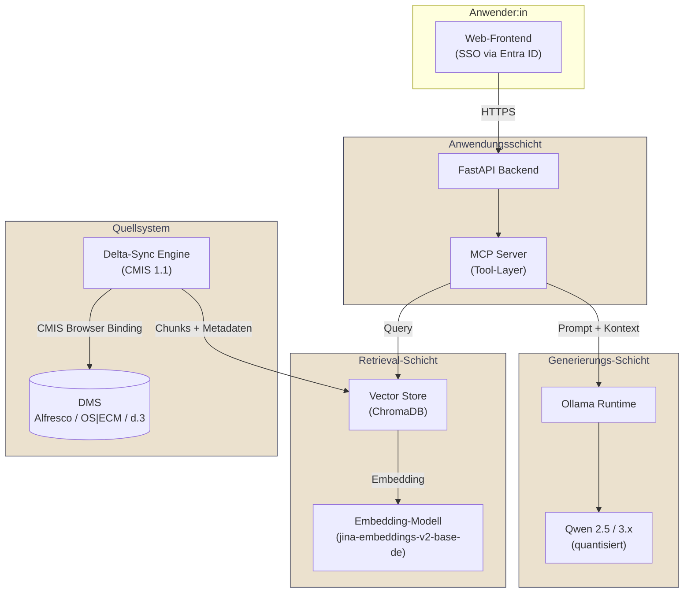

# Referenzarchitektur: On-Premise RAG über E-Akten-Bestände

## Kontext

Behörden verfügen über große, organisch gewachsene Aktenbestände in Dokumentenmanagementsystemen (DMS) wie Alfresco, OS|ECM oder d.3. Die manuelle Recherche darin bindet erhebliche Bearbeitungskapazitäten. Retrieval-Augmented Generation (RAG) ermöglicht semantische Suche und assistierte Antworten – muss in Verwaltungskontexten jedoch zwingend **on-premise** und **berechtigungsbewusst** umgesetzt werden.

## Architekturüberblick

## Komponenten

| Schicht | Komponente | Aufgabe |
|---|---|---|
| Frontend | Web-UI mit SSO | Authentifizierung über Microsoft Entra ID oder vorhandenes IdM |
| Anwendung | FastAPI + MCP Server | Orchestrierung, Tool-Aufrufe, Audit-Logging |
| Retrieval | ChromaDB | Vektorindex mit Metadaten und ACL-Referenzen pro Chunk |
| Retrieval | Deutsches Embedding-Modell | Semantische Repräsentation behördlicher Texte |
| Generierung | Ollama + Qwen | Antwortsynthese vollständig im Haus |
| Quellsystem | CMIS-Sync-Engine | Initial- und Delta-Indexierung über das standardisierte CMIS-Protokoll |

## Sicherheits- und Compliance-Eigenschaften

- **Keine Datenabflüsse**: Sämtliche Verarbeitung erfolgt innerhalb der Behörden- oder Dienstleister-Infrastruktur.
- **Berechtigungsbewusstsein**: Jeder indexierte Chunk trägt eine Referenz auf das ursprüngliche Berechtigungsobjekt im DMS. Autorisierungsentscheidungen verbleiben im Quellsystem.
- **Auditierbarkeit**: Alle Suchanfragen und LLM-Antworten werden mit Nutzerkontext protokolliert.
- **EU AI Act**: Die Behörde tritt als Betreiber auf; die transparente Kennzeichnung der KI-Interaktion erfolgt in der Benutzeroberfläche.

## Typische Dimensionierung

- 10.000–100.000 Dokumente
- 50.000–500.000 indexierte Chunks
- 50–500 gleichzeitige Nutzer:innen
- GPU: ab NVIDIA RTX 6000 Ada / Blackwell für produktiven Betrieb

---

*Diese Architektur ist eine generische Referenz und ersetzt keine projektspezifische Konzeption.*
