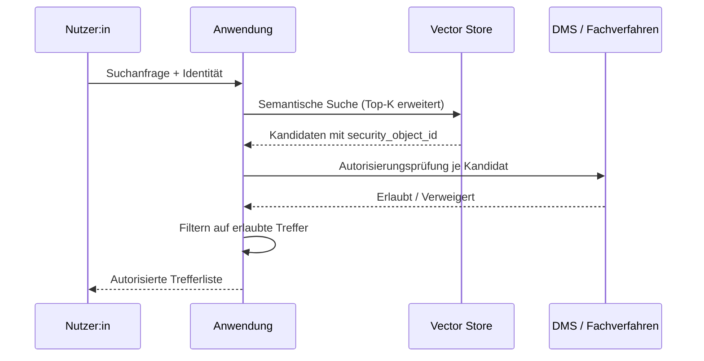

# Referenzarchitektur: Berechtigungsbewusste semantische Suche

## Problemstellung

Klassische Vektorsuche kennt keine Zugriffsrechte: Wer Zugriff auf den Index hat, sieht alle Treffer. In Behördenkontexten ist das nicht akzeptabel – Personalakten, laufende Verfahren und Verschlusssachen verlangen feingranulare Autorisierung, die mit dem Quellsystem konsistent bleibt.

## Lösungsansatz

Berechtigungsentscheidungen verbleiben im **Quellsystem** (DMS, Fachverfahren). Der Vektorindex speichert pro Chunk nur eine **Referenz** auf das Berechtigungsobjekt. Bei jeder Suche werden Treffer gegen die Live-Berechtigung des aufrufenden Nutzers geprüft.

## Designentscheidungen

| Entscheidung | Begründung |
|---|---|
| ACLs **nicht** im Vektorindex spiegeln | Inkonsistenzen zwischen Index und Quellsystem führen zu Datenschutzvorfällen. |
| Über Top-K hinaus suchen | Nach Autorisierungsfilterung bleiben weniger Treffer übrig; Faktor 2–5 als Reserve. |
| Caching der Autorisierungsentscheidungen | Kurze TTL (z. B. 60 s) reduziert Last auf das Quellsystem ohne Risiko verzögerter Sperrungen zu erhöhen. |
| Audit-Trail aller verweigerten Zugriffe | Pflicht für Revision und Datenschutz-Folgenabschätzung. |

## Integrationsvarianten

- **Polling-basiert**: Periodische Delta-Synchronisation via CMIS `lastModificationDate`. Robust, aber latenzbehaftet.
- **Webhook-basiert**: Quellsystem benachrichtigt aktiv über Änderungen. Schnell, erfordert aber Erweiterung des Quellsystems.
- **Change Data Capture (CDC)**: Auf Datenbankebene; nur sinnvoll bei eigenem Hosting des Quellsystems.

## Hinweis für Vergabeverfahren

Die Anforderung „berechtigungsbewusste KI-Suche" sollte in Leistungsbeschreibungen **nicht** durch eine Spiegelung der ACLs in den Index ausgelegt werden. Dies ist eine häufige, aber riskante Vereinfachung.
